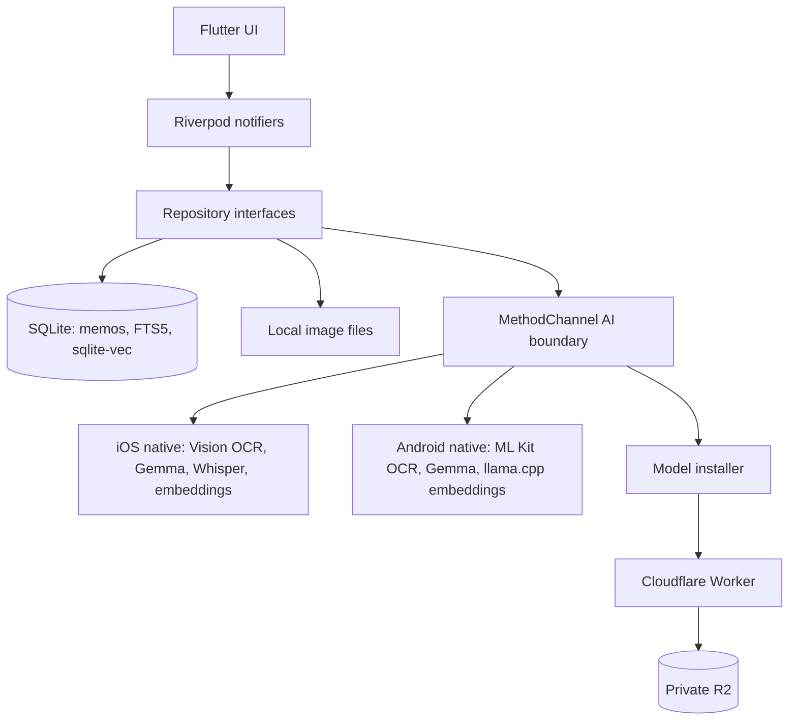

# Cluemori

A local-first personal knowledge app. Capture a screenshot, a voice note, or a line of text, and an on-device AI model turns it into a structured memo with a title, summary, keywords, and intent. Memos are then rediscoverable through search and a knowledge graph.

Everything runs on the device. There is no account, no user-data backend, and no cloud inference.

> **Source is private.** Cluemori is being prepared for commercial release, so this repository is a showcase: what the app does, how it is built, and the engineering problems behind it.

<!-- TODO: add 3-4 screenshots or a short demo GIF here (capture flow, memo detail, search, knowledge graph) -->

## What it does

- **Three capture paths.** Text, one or more images (OCR), and voice (speech to text).
- **AI structuring.** The model proposes a title, summary, keywords, and intent. The user reviews and edits before saving.
- **Library.** Memo list with intent filters, memo detail with the original source preserved, and follow-up notes with image attachments.
- **Search.** Full-text search over titles, summaries, and keywords.
- **Knowledge graph.** Memos are embedded on device, and similar memos are linked and explorable as a graph.
- **Model management.** Models are downloaded on request, verified, cached, and reused offline.
- English and Korean UI, with a separate speech-language setting.

## Tech stack

| Layer | Tools |
|---|---|
| App | Flutter, Dart, Riverpod, go_router, Material 3 |
| Storage | SQLite with FTS5 for full-text search and sqlite-vec for vector search |
| LLM | Gemma 3n (INT4 quantized), run natively on iOS and Android |
| Embeddings | EmbeddingGemma through llama.cpp |
| Speech and OCR | Whisper, Apple Vision on iOS, ML Kit on Android |
| Model delivery | Cloudflare Worker in front of a private R2 bucket |
| Testing | flutter_test, Patrol for iOS end-to-end tests |

## Architecture

The Flutter code is layered into `presentation`, `domain`, `data`, and `core`. Every data source, including the AI engine, sits behind a repository interface. Errors cross the repository boundary as typed failures, not exceptions.

## Engineering highlights

**One native AI boundary.** All model work (status, download, text analysis, OCR, transcription, embeddings) goes through a single MethodChannel contract. Flutter code has no native AI dependencies, and each platform implements the same contract with its own runtime.

**Verified model delivery for a 3 GB model.** A shared catalog lists every model file with its size and SHA-256 hash. The installer downloads only when the user asks, verifies bytes and checksum before loading, supports cancellation, and reuses the cache offline. The Worker only serves fixed catalog paths from a private bucket.

**Resilient structured output.** Small on-device models do not always return clean JSON. A single Dart parser handles both platforms' responses, validates required keys, repairs recoverable output, and returns a typed failure when it cannot, so a bad generation never becomes a corrupt memo.

**Hybrid retrieval in one local database.** Keyword search uses FTS5 and semantic links use sqlite-vec, both in the same SQLite file. Database work runs on a background isolate.

**Safe schema evolution.** Migrations are sequential and versioned, run atomically, and are covered by data-preservation checks so existing memos and images survive upgrades.

**Documented decisions.** Architecture decision records cover local storage, the native AI boundary, and the layered Riverpod design. Each feature has its own requirement document.

## Testing

- 41 test files covering unit, widget, and contract tests.
- Patrol end-to-end suites (smoke and regression) run on an iOS simulator through a single script.

## Status

In development. About 16K lines of Dart plus native iOS and Android code, 69 commits since March 2026.

<!-- TODO: add App Store / Google Play links once the listing is public -->
